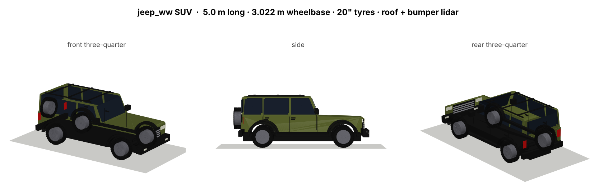
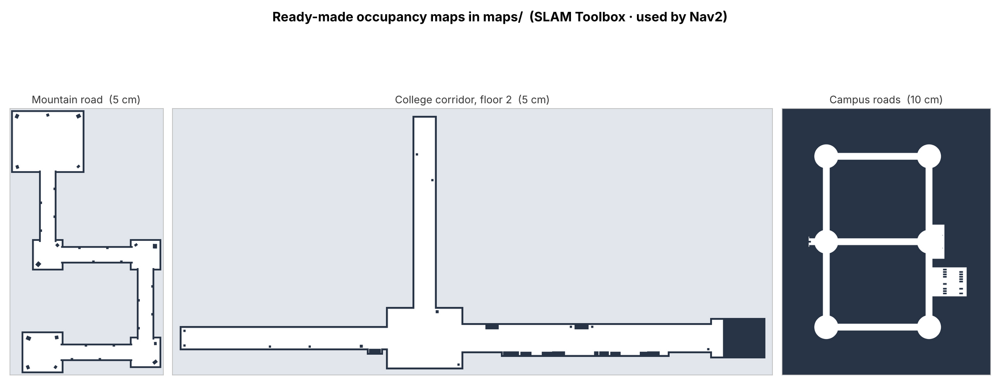

# jeep_ww

Full-size 4-door off-road SUV on a mountain road, with SLAM mapping and Nav2 navigation.
ROS 2 Jazzy + Gazebo Harmonic.

- SUV: 5.0 m long, 3.022 m wheelbase, 1.70 m track, 20" tyres, ~2.3 t,
  car-like (Ackermann) steering, 2D lidar on the roof (2.1 m up)
- World: a road climbing 16.8 m in four 40 m ramps (6 deg) to a summit plateau
- The SUV spawns at (0, 0) facing east; the summit is at (7, 116)

## Install (once)
    sudo apt install ros-jazzy-ros-gz ros-jazzy-xacro ros-jazzy-slam-toolbox \
      ros-jazzy-navigation2 ros-jazzy-nav2-bringup ros-jazzy-teleop-twist-keyboard \
      ros-jazzy-joint-state-publisher-gui
    cd ~/bot_ws && colcon build --packages-select jeep_ww

Every new terminal:

    cd ~/bot_ws && source install/setup.bash

## 1. Mapping
Automatic (the SUV drives up and back down by itself):

    ros2 launch jeep_ww mapping.launch.py auto:=true

Or drive yourself:

    ros2 launch jeep_ww mapping.launch.py
    ros2 run teleop_twist_keyboard teleop_twist_keyboard   # 2nd terminal: i, u/o, ',' and w = faster

Save the map (when the drive is finished):

    ros2 run jeep_ww save_map          # -> ~/bot_ws/src/jeep_ww/maps/my_map.yaml

## 2. Navigation
    ros2 launch jeep_ww navigation.launch.py goal:=summit                  # drives to the summit by itself
    ros2 launch jeep_ww navigation.launch.py                               # click "2D Goal Pose" in RViz
    ros2 launch jeep_ww navigation.launch.py map:=$HOME/bot_ws/src/jeep_ww/maps/my_map.yaml

Send more goals from a 2nd terminal:

    ros2 run jeep_ww go_to summit       # or ramp1, bend1, ramp2, bend2, ramp3, bend3, ramp4
    ros2 run jeep_ww go_to 63 30 90     # x y yaw(deg)

Drive back down to the start:

    ros2 run jeep_ww auto_drive --ros-args -p route:=down

## 3. College floor world (Mechatronics department, floor 2)
Built from photos of the department floor: main corridor with faculty room 217, two groups of
lit display cabinets, NB-208 lab, benches and posters, department banner, stair hall (flight up
and down), lobby with the floor-2 direction sign, lift and fire exit, the water-cooler corridor
and the Tinkerers' Lab corridor. How the corridors join is an assumption (not visible in the photos).

    ros2 launch jeep_ww college_world.launch.py      # Gazebo world + its 2D map in RViz

- World: worlds/college_corridor.sdf   Map: maps/college_corridor.yaml (5 cm, lidar height 0.3 m)
- Start pose for a robot: (0, 0) facing +x (down the main corridor). Stairs are a keep-out area.
- The SUV is too big for indoor corridors: use a small robot here.
- Regenerate after edits: python3 tools/make_corridor_world.py

## 4. University campus world (Chitkara University, Rajpura - layout approximate)
Main gate on the highway, boulevard with hedges, cypress trees and street lights up to the
Turing Block (red fins, colourful mural), big central lawn with garden and fountain, woods with
the Galileo Block, Babbage, Fleming, Tesla, Picasso, Le Corbusier, Bloom, Square One, Edison and
Newton blocks, parking, and a road loop with an open turning circle at every junction.
Block names are real; their positions and the road layout are an assumption.

    ros2 launch jeep_ww campus.launch.py auto:=true            # SUV tours the campus by itself (SLAM map builds)
    ros2 launch jeep_ww campus.launch.py                       # drive yourself with teleop
    ros2 run jeep_ww save_map ~/bot_ws/src/jeep_ww/maps/my_campus_map

    ros2 launch jeep_ww campus_navigation.launch.py goal:=turing   # Nav2 drives to the Turing Block
    ros2 run jeep_ww go_to picasso                                 # more goals, 2nd terminal

Places for go_to / goal:=  turing, babbage, fleming, bloom, corbusier, picasso, galileo,
square_one, edison, newton, tesla, parking, main_gate.  Or click "2D Goal Pose" in RViz.

- Navigation localises with slam_toolbox and plans on maps/chitkara_campus_roads.yaml, so the
  SUV stays on the roads. localization:=amcl uses AMCL on maps/chitkara_campus.yaml instead.
- Regenerate after edits: python3 tools/make_campus_world.py

### Moving people and traffic (on by default in the campus launches)
- 11 people walk the boulevard footpaths, cross at the zebra crossing (x = 94) and in front of the
  Turing Block, walk the lawn paths and pace by the gate; they pause on the pavement between crossings.
- Campus cars and a campus bus drive round the road loops in the left-hand lane; 8 cars run on
  the highway in both directions.
- They are Gazebo actors (no collision). The SUV's front bumper lidar (/front_scan, 0.55 m high, 180 deg)
  sees them - the roof lidar at 2.1 m is above people and cars.
- auto tour: stops and waits when someone is in its path (auto_drive stop_for_obstacles:=true).
- Nav2: the collision monitor uses /front_scan, so the SUV slows down and waits, then drives on.
- traffic:=false gives the empty campus.  World file: worlds/chitkara_campus_traffic.sdf
- Walking person: meshes/walk.dae from Gazebo Classic (Apache-2.0, OSRF) - see meshes/walk.dae.NOTICE.
  Vehicles: tools/make_traffic_meshes.py

## Tips
- Before every new launch, stop leftovers from older runs:  `ros2 run jeep_ww stop_sim`
- Wait for "Managed nodes are active" before sending Nav2 goals.
- The SUV cannot turn on the spot: give goals facing the direction of travel.
- Gazebo window crashing on WSL? Add `headless:=true` to any launch (RViz still shows everything).
- RViz black on WSL? `export LIBGL_ALWAYS_SOFTWARE=1` before launching.

## Package layout
    launch/   display, gazebo, mapping, navigation, college_world, campus, campus_navigation
    urdf/     jeep_ww.urdf.xacro (SUV, steering plugin, lidar)
    meshes/   SUV and mountain scenery
    worlds/   mountain_road.sdf, college_corridor.sdf, chitkara_campus.sdf, chitkara_campus_traffic.sdf
    maps/     mountain_road.yaml/.pgm (ready-made map)
    config/   nav2_params.yaml, navigate_car.xml, slam_params.yaml, gz_bridge.yaml, *.rviz
    jeep_ww/  auto_drive, go_to, save_map, stop_sim
    tools/    scripts that generate the SUV meshes, world and map
    docs/     README images (regenerate: python3 tools/render_readme_images.py . docs)
